# GovPrep — Government Job Preparation Platform

GovPrep is a full-stack web application designed to help government job aspirants discover job opportunities, explore competitive exams, organize their preparation, and track their progress through a centralized dashboard.

The project is built with React, Tailwind CSS, Node.js, Express.js, and MongoDB.

**GitHub Repository:** https://github.com/mahesh-samaji/government-job-aspirant

---

## Application Screenshots

### 1. Landing Page
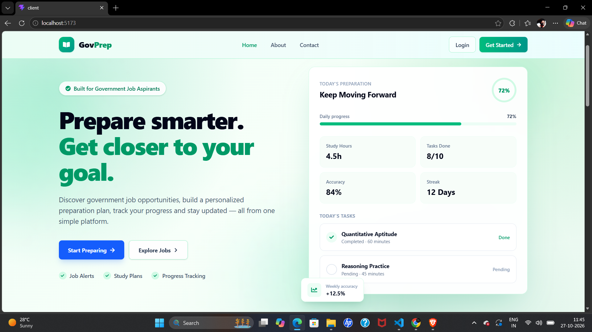

### 2. Dashboard
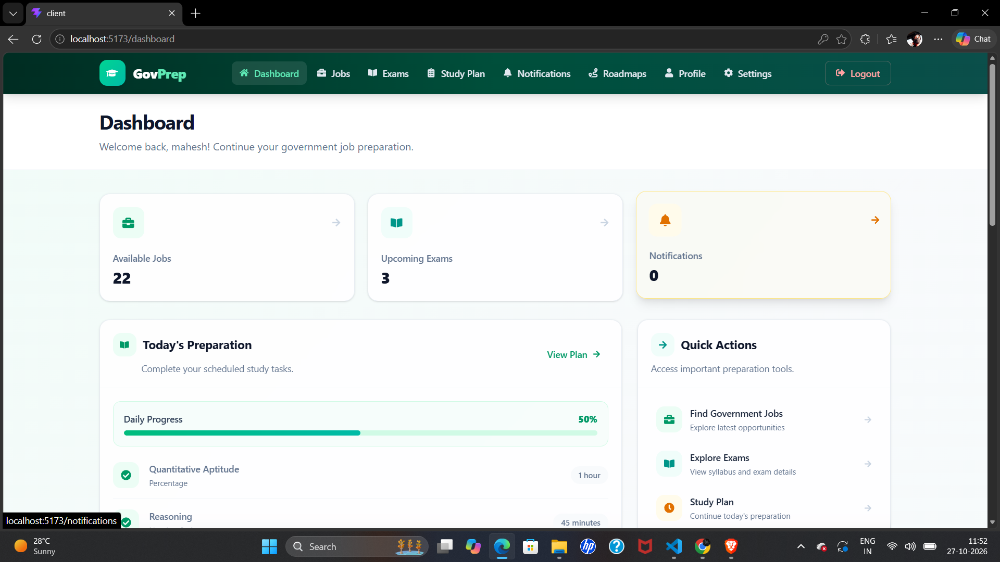

### 3. Registration Page
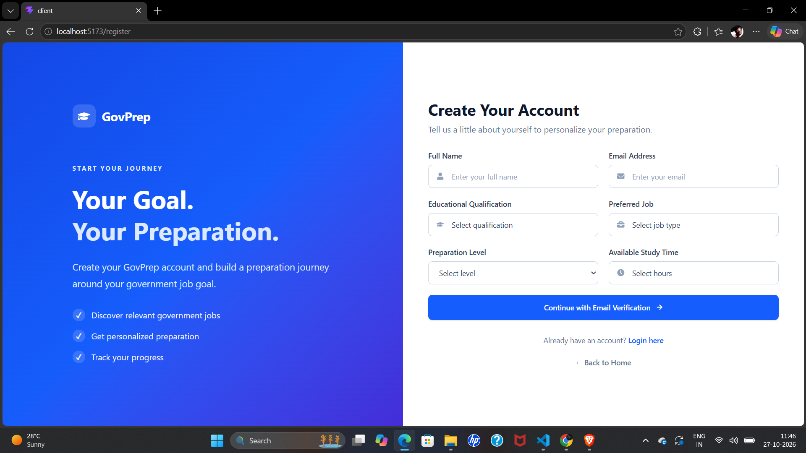

### 4. Login Page
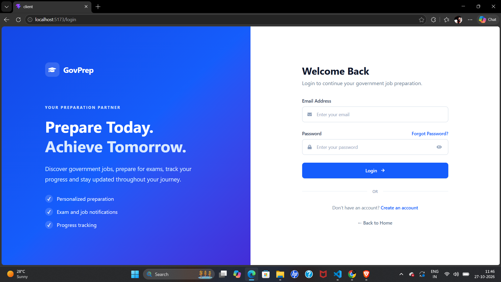

### 5. Jobs Page
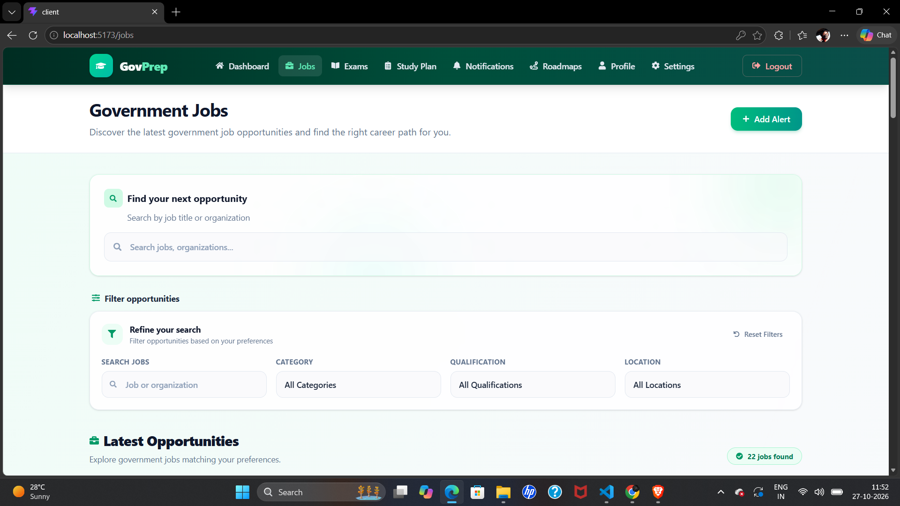

### 6. Exams Page
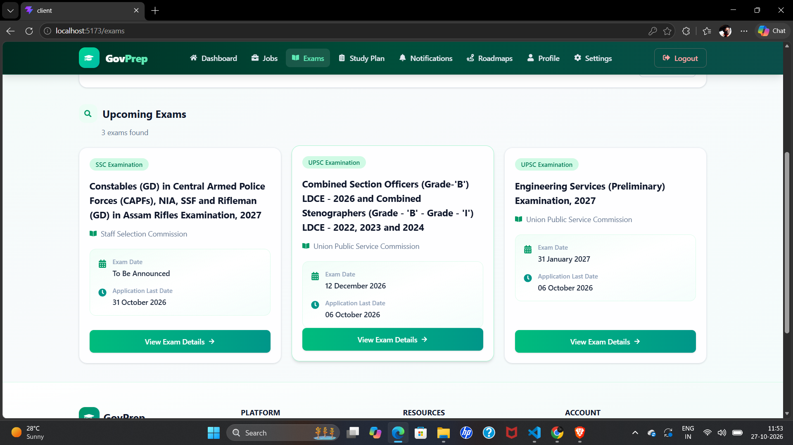

### 7. Exam Details Page
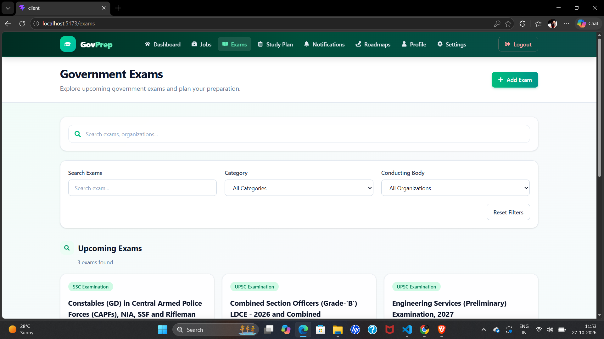

### 8. Study Plan
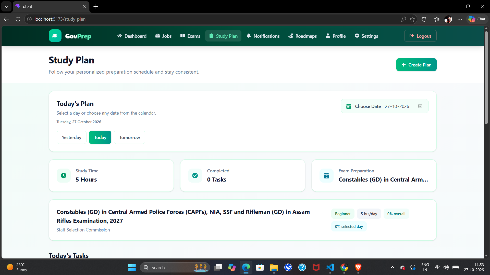

### 9. Roadmaps Page
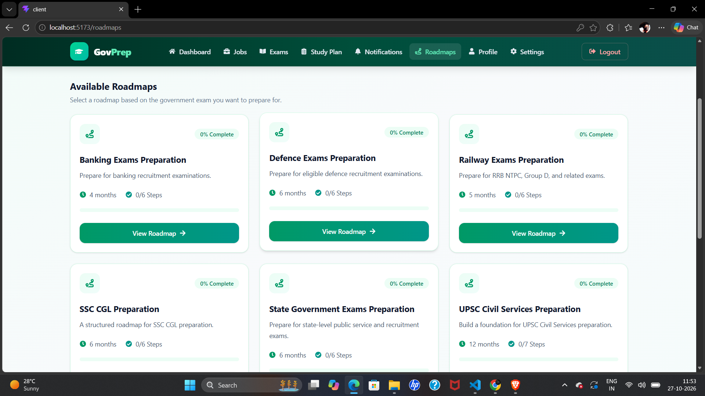

### 10. Roadmap Details Page
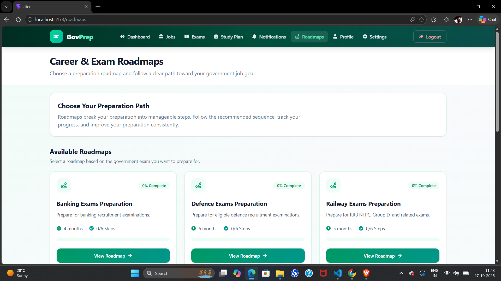

### 11. Settings Page
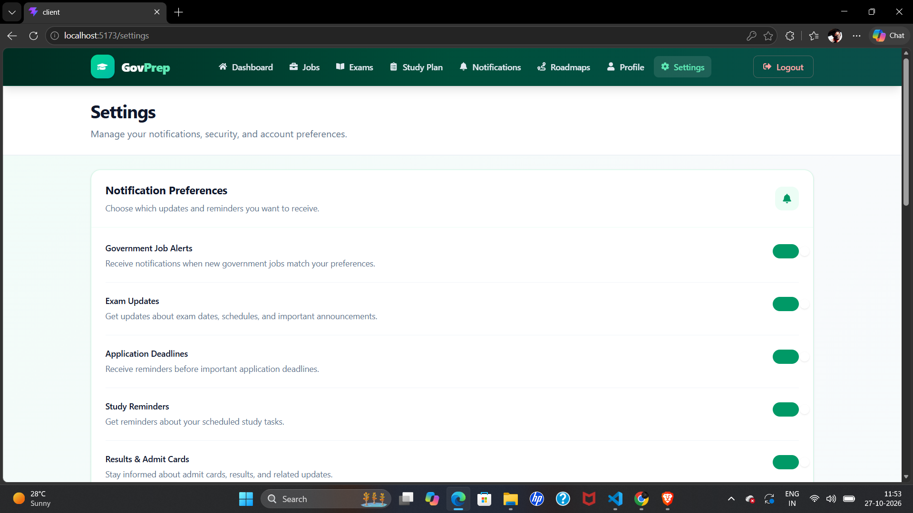

### 12. Jobs Page — Additional View


---

## Features

### User Interface
- Responsive interface built with React and Tailwind CSS.
- Dedicated landing page and informational pages.
- Structured dashboard for accessing preparation-related modules.
- Reusable components and modular page organization.

### Authentication and User Management
- User registration and login functionality.
- Email verification using OTP.
- Password validation.
- Forgot-password and password-reset workflow.
- Backend authentication endpoints.

### Government Jobs
- Job listings interface.
- Job-related information and details pages.
- Job discovery experience for government job aspirants.

### Competitive Exams
- Exams listing interface.
- Dedicated exam details pages.
- Centralized access to exam preparation information.

### Study Planning and Roadmaps
- Study plan interface for organizing preparation.
- Roadmaps to help structure learning and preparation.
- Dedicated pages for study planning and settings.

### Backend and Database
- REST API architecture using Express.js.
- MongoDB integration using MongoDB Atlas.
- Environment-based configuration for sensitive credentials.
- Email delivery integration using Nodemailer.

> Note: The availability of each feature depends on its current implementation in the source code. Some modules may still be under development.

---

## Technology Stack

### Frontend
- React
- JavaScript
- Tailwind CSS
- React Router
- React Icons
- Vite

### Backend
- Node.js
- Express.js
- REST APIs

### Database
- MongoDB
- MongoDB Atlas

### Additional Tools and Services
- Nodemailer for email delivery
- Git and GitHub for version control
- npm for package management

---

## Project Structure

```text
government-job-aspirant/
│
├── Client/
│   ├── public/
│   ├── src/
│   │   ├── components/
│   │   ├── pages/
│   │   ├── layouts/
│   │   ├── routes/
│   │   └── ...
│   ├── package.json
│   └── .gitignore
│
├── server/
│   ├── config/
│   ├── controllers/
│   ├── models/
│   ├── routes/
│   ├── services/
│   ├── utils/
│   ├── package.json
│   └── .gitignore
│
├── screenshots/
│   ├── Dashboard.jpg.png
│   ├── Landingpage.jpg.png
│   ├── Studyplan.jpg.png
│   ├── exampage.jpg.png
│   ├── exams.jpg.png
│   ├── jobs.jpg (2).png
│   ├── jobs.jpg.png
│   ├── loginpage.jpg.png
│   ├── registrationpage.jpg.png
│   ├── roadmappaage.jpg.png
│   ├── roadmaps.jpg.png
│   └── settingspage.jpg.png
│
├── .gitignore
├── README.md
└── test-api.js
```

*The folder names above describe the intended organization. Refer to the actual source tree for the exact files and subfolders.*

---

## Getting Started

Follow these steps to run GovPrep locally.

### Prerequisites

Install the following before starting:

- [Node.js](https://nodejs.org/) — preferably an active LTS version.
- npm, which is included with Node.js.
- A [MongoDB Atlas](https://www.mongodb.com/atlas) account or another MongoDB instance.
- Git.

### 1. Clone the Repository

```bash
git clone https://github.com/mahesh-samaji/government-job-aspirant.git
cd government-job-aspirant
```

### 2. Install Frontend Dependencies

```bash
cd Client
npm install
```

### 3. Configure Frontend Environment Variables

Check the frontend source code for any environment variables it requires. If needed, create a `Client/.env` file and add the appropriate values.

Do not commit real credentials or private keys.

### 4. Start the Frontend

From the `Client` directory, run:

```bash
npm run dev
```

Vite will display the local development URL in the terminal, commonly `http://localhost:5173`.

### 5. Install Backend Dependencies

Open a separate terminal from the project root and run:

```bash
cd server
npm install
```

### 6. Configure Backend Environment Variables

Create a `server/.env` file. Add the variables required by your backend configuration.

Example template:

```env
PORT=5000
MONGO_URI=your_mongodb_connection_string
EMAIL_USER=your_email_address
EMAIL_PASSWORD=your_email_app_password
```

Replace the example values with your own configuration. Use an email provider's app password where required; never use or publish your regular account password.

If your code requires additional environment variables, add them to your local `.env` file as appropriate.

### 7. Start the Backend

From the `server` directory, use the script defined in `server/package.json`. For example, if the project defines a `dev` script:

```bash
npm run dev
```

If it defines a `start` script instead, run:

```bash
npm start
```

The backend is expected to run on `http://localhost:5000` when configured with `PORT=5000`.

---

## API Testing

The repository includes a root-level `test-api.js` script for testing the login endpoint.

To use it, first ensure that the backend is running and that you have a test account. Open a terminal in the project root and set the test credentials in your terminal session.

**PowerShell:**

```powershell
$env:TEST_EMAIL="your_test_email"
$env:TEST_PASSWORD="your_test_password"
node test-api.js
```

The script sends a login request to:

```text
POST http://localhost:5000/api/auth/login
```

It prints the HTTP status and API response to the terminal.

Use only your own test account. Do not add real credentials to source code or commit them to GitHub.

---

## Security Practices

- Sensitive configuration is stored in environment variables.
- `.env` files are excluded through `.gitignore`.
- Dependency directories such as `node_modules` are excluded from version control.
- The API uses a modular backend structure.
- Email and database credentials should remain private.

**Important:** `.gitignore` does not remove secrets that were committed previously. Before publishing a repository, check the Git history and source files for exposed credentials. Rotate any credentials that may have been exposed.

---

## Current Development Status

GovPrep is an ongoing full-stack project. The frontend provides the main application interface, while backend authentication, database connectivity, email verification, and API functionality have been developed and tested during development.

Further improvements may include:
- Expanding job and exam data coverage.
- Completing and integrating remaining frontend modules with backend APIs.
- Improving validation, authorization, and error handling.
- Adding automated tests.
- Preparing production deployment and monitoring.

---

## Future Enhancements

- Personalized preparation plans based on exam dates and available study hours.
- Job and exam deadline notifications.
- Progress tracking and performance analytics.
- Expanded syllabus and previous-year-question resources.
- Administrative tools for managing jobs, exams, and content.
- Production deployment with improved scalability and monitoring.

---

## Learning Outcomes

This project demonstrates practical experience with:

- Full-stack web application development.
- React component-based architecture.
- Tailwind CSS styling.
- REST API development using Node.js and Express.
- MongoDB integration.
- Authentication and email verification workflows.
- Environment configuration and secret management.
- Git and GitHub version control.

---

## Author

**Mahesh Samaji**

B.Tech — Electronics and Communication Engineering (ECE)

Interested in full-stack development, frontend engineering, and building practical web applications.

**GitHub:** [mahesh-samaji](https://github.com/mahesh-samaji)

---

## License

This project is available for review and learning. A formal license has not been specified yet.
